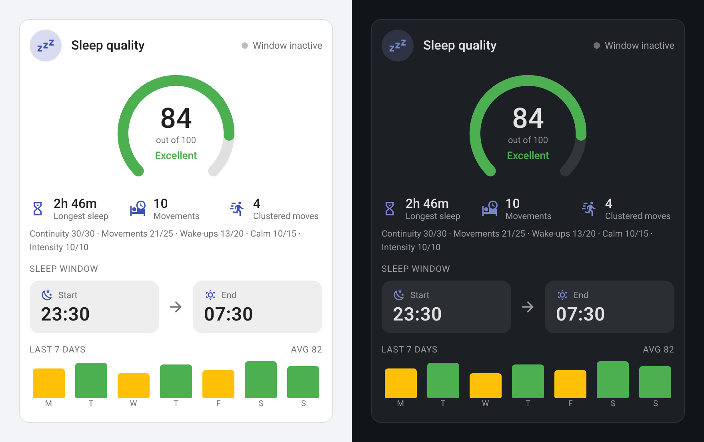
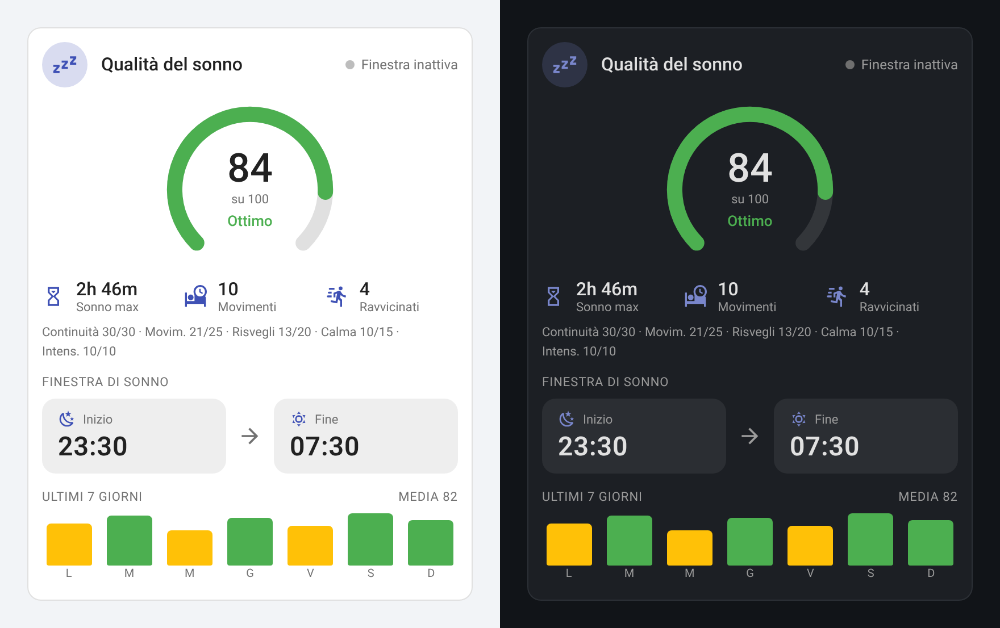

# Bed Sleep Score

[](https://hacs.xyz/docs/faq/custom_repositories)
[](https://github.com/artech-lab/ha-bed-sleep-score/releases)
[](https://github.com/artech-lab/ha-bed-sleep-score/actions/workflows/validate.yml)
[](LICENSE)

A nightly **0–100 sleep quality score** from an accelerometer on your bed — for example an MPU6050
on an ESP32 running ESPHome. Pick the acceleration sensors, add the card: the integration does the
whole analysis. No helpers, no templates, no automations, no YAML.

Everything runs locally inside Home Assistant. The interface is available in English and Italian.



## How it works

```text
acceleration X, Y, Z  →  magnitude  →  rolling standard deviation ("agitation")
                      →  movement episodes  →  night counters  →  score at the end of the sleep window
```

One package contains every step:

- **Signal analysis** — the integration reads the raw acceleration axes, computes the magnitude and its
  2-minute standard deviation, and detects movement episodes with hysteresis.
- **Night tracking** — inside the sleep window it counts the movements, the clustered movements
  (a proxy for awakenings) and the longest undisturbed stretch. Counters survive restarts; a reset or a
  score missed while Home Assistant was down is recovered at startup.
- **Score** — five components anchored to published sleep research ([details](#the-score)).
- **Dashboard card** — served and loaded by the integration itself: no dashboard resource to add, and it
  is always the version that matches the integration.

## Requirements

- Home Assistant 2025.2 or newer.
- An accelerometer fixed to the bed frame (not the mattress) that reports its axes in m/s² about once
  per second. With ESPHome and an MPU6050 this is all you need:

```yaml
i2c:
  sda: GPIO21
  scl: GPIO22

sensor:
  - platform: mpu6050
    update_interval: 1s
    accel_x:
      name: "Bed accel X"
    accel_y:
      name: "Bed accel Y"
    accel_z:
      name: "Bed accel Z"
```

A single sensor that already holds the acceleration magnitude works too.

> These sensors change every second. To keep the database small, exclude them from the
> [recorder](https://www.home-assistant.io/integrations/recorder/#exclude): the integration only needs
> their live values.

## Installation

[](https://my.home-assistant.io/redirect/hacs_repository/?owner=artech-lab&repository=ha-bed-sleep-score&category=integration)

1. In HACS (*Marketplace* from Home Assistant 2026.11) search for **Bed Sleep Score**. If it is not
   listed, add `https://github.com/artech-lab/ha-bed-sleep-score` as a custom repository with type
   **Integration**.
2. Download it and restart Home Assistant.

Manual alternative: copy `custom_components/bed_sleep_score` into your `custom_components` folder and
restart.

## Setup

[](https://my.home-assistant.io/redirect/config_flow_start/?domain=bed_sleep_score)

1. *Settings → Devices & services → Add integration → Bed Sleep Score*.

   | Field | Description |
   | --- | --- |
   | Name | Device name and prefix of the entity IDs (default `Sleep tracker`). |
   | Bed accelerometer sensors | The X, Y and Z acceleration sensors (or one magnitude sensor). |
   | Presence entity | Optional. The night is scored only when it is `home`/`on`, so an empty bed is not mistaken for a perfect night. |
   | Sleep window start / end | Default 00:00 → 08:00. Windows across midnight are supported. |

2. In a dashboard: *Add card → Bed Sleep Score*. The card finds its entities by itself.

   ```yaml
   type: custom:bed-sleep-score-card
   entity: sensor.sleep_tracker_score
   ```

The first score appears at the end of the first complete sleep window.

### Card options

| Option | Default | Description |
| --- | --- | --- |
| `entity` | — | **Required.** The sleep score sensor. |
| `name` | "Sleep quality" (localized) | Card title. |
| `history_days` | `7` | Days in the history chart (3–14). |
| `show_breakdown` | `true` | Per-component line under the chips. |
| `show_window` | `true` | Editable sleep window. |
| `show_history` | `true` | History chart and 7-day average. |

Tap the ring or a chip to open the related entity; tap a window time to change it.



## Entities

Entity IDs are always in English (shown here with the default name); displayed names follow the
language of Home Assistant.

| Entity | Description |
| --- | --- |
| `sensor.sleep_tracker_score` | Score of the last night. Attributes: `night_of`, `components`, `continuity_minutes`, `movements`, `clustered_movements`, `net_agitation`, `peak_agitation`, `samples`, `neutral_signal`. |
| `sensor.sleep_tracker_score_7_day_average` | Exponential moving average of the score (≈ 7 days). |
| `sensor.sleep_tracker_movements` | Movement episodes of the night. |
| `sensor.sleep_tracker_clustered_movements` | Movements less than 15 minutes after the previous one. |
| `sensor.sleep_tracker_longest_undisturbed_sleep` | Longest stretch without movements, in minutes. |
| `binary_sensor.sleep_tracker_window_active` | `on` inside the sleep window. |
| `binary_sensor.sleep_tracker_movement` | `on` while the bed is moving. |
| `time.sleep_tracker_window_start`, `time.sleep_tracker_window_end` | The sleep window. |
| `sensor.sleep_tracker_agitation` | Diagnostic, disabled by default: the analysed signal, for tuning. |

The night counters restart at the beginning of the window and keep last night's values during the day.
Use them freely in automations, for example to dim the lights when the score is low.

## The score

| Component | Points | Measure | Full points | Zero points |
| --- | --- | --- | --- | --- |
| Continuity | 30 | Longest undisturbed stretch, window edges included | ≥ 120 min | ≤ 30 min |
| Movements | 25 | Movement episodes | ≤ 8 | ≥ 20 |
| Wake-ups | 20 | Clustered movements (the first of the night excluded) | ≤ 2 | ≥ 8 |
| Calm | 15 | Net agitation: mean − minimum of the signal | ≤ 0.008 | ≥ 0.020 |
| Intensity | 10 | Peak agitation, log scale | ≤ 0.3 | ≥ 3.0 |

Components are linear between their anchors. If too little signal was collected, calm and intensity
count half and `neutral_signal` is `true`.

- **Continuity** — 120 minutes is about one complete sleep cycle (90–110 min).
- **Movements** — video studies count 12–20 posture changes per night in healthy sleepers and about
  twice as many in poor sleepers [2]; a bed accelerometer only sees the larger ones.
- **Wake-ups** — an awakening produces a burst of movements, a posture change is isolated. The National
  Sleep Foundation rates ≤ 1 awakening longer than 5 minutes as good sleep and ≥ 4 as poor [1].
- **Calm** — mean minus minimum ignores constant offsets such as a fan or the sensor noise.
- **Intensity** — movement intensity during sleep correlates with autonomic activation [3].

> A comfort and habit indicator, not a medical device: it measures the agitation of the bed inside a
> time window, not sleep stages or time asleep.

### Tuning

There is one setting, in *Settings → Devices & services → Bed Sleep Score → Configure*: the **movement
threshold** (default 0.102 m/s²), the agitation above which a movement starts. The calm and intensity
scales follow it proportionally, so it is the only value to adapt to a different sensor or bed.

Enable the diagnostic `Agitation` sensor for a couple of nights: set the threshold clearly above its
quiet level and below the spikes you see when turning over. Lower it if movements are missed, raise it
if too many are counted.

## Troubleshooting

- **The card is not in the card picker** — reload the browser page once after installing or updating.
- **The score is `unknown`** — it is calculated at the end of the first complete window; with a presence
  entity, that entity must be `home`/`on` at that time.
- **Something else** — attach the diagnostics (*device page → ⋮ → Download diagnostics*) to a
  [new issue](https://github.com/artech-lab/ha-bed-sleep-score/issues).

## Contributing

```bash
python -m venv .venv && . .venv/bin/activate && pip install -r requirements_test.txt
scripts/check.sh
```

The version lives only in `manifest.json`; pushing a new one to `main` publishes the release once the
checks pass. See [`CLAUDE.md`](CLAUDE.md) for the layout of the code.

## References

1. Ohayon M. et al. *National Sleep Foundation's sleep quality recommendations: first report.*
   Sleep Health, 2017. [doi:10.1016/j.sleh.2016.11.006](https://doi.org/10.1016/j.sleh.2016.11.006)
2. Cary D. et al. *Examining relationships between sleep posture, waking spinal symptoms and quality of
   sleep: a cross sectional study.* PLOS ONE, 2021.
   [doi:10.1371/journal.pone.0260582](https://doi.org/10.1371/journal.pone.0260582)
3. Sicbaldi M. et al. *Mapping the physiological landscape of body movements during nocturnal sleep and
   wakefulness and their cardiovascular correlates with a wearable multi-sensor array.* Scientific
   Reports, 2025. [doi:10.1038/s41598-025-29723-7](https://doi.org/10.1038/s41598-025-29723-7)

## License

Copyright © 2026 The ha-bed-sleep-score contributors. Released under the
[GNU General Public License v3.0 or later](LICENSE).
